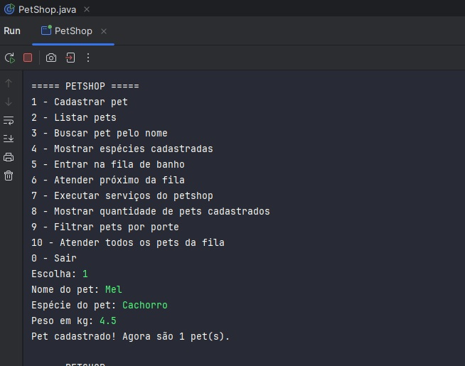

# PetShop — ElasTech Java

Projeto desenvolvido durante o bootcamp ElasTech Java para praticar os fundamentos da linguagem Java, Programação Orientada a Objetos e princípios de design de software.

A aplicação consiste em um sistema simples de gerenciamento de pets executado pelo terminal.

## Funcionalidades

- Cadastro e listagem de pets.
- Busca de pets pelo nome.
- Filtro de pets por porte.
- Consulta das espécies cadastradas.
- Contagem de pets.
- Fila de banho com atendimento individual ou em lote.
- Execução de serviços de banho, tosa, consulta e vacina.
- Validação de dados e tratamento de entradas inválidas.

## Demonstração

O sistema é executado pelo terminal e apresenta um menu interativo para acessar as funcionalidades.



## Estrutura do projeto

```text
src/
└── br/com/petshop/
    ├── PetShop.java
    ├── dominio/
    │   ├── Pet.java
    │   ├── Cachorro.java
    │   ├── Gato.java
    │   ├── Porte.java
    │   └── Servico.java
    ├── servicos/
    │   ├── Banho.java
    │   ├── Tosa.java
    │   ├── Consulta.java
    │   └── Vacina.java
    ├── repositorio/
    │   ├── PetRepository.java
    │   └── MemoriaPetRepository.java
    ├── fila/
    │   └── FilaBanho.java
    └── fabrica/
        └── PetFactory.java
```

## Tecnologias

- Java
- IntelliJ IDEA
- Execução via terminal

## Conceitos praticados

- Variáveis e tipos de dados.
- Strings e seus métodos.
- Condicionais (`if` e `switch`).
- Laços de repetição (`while` e `for`).
- `Scanner`.
- Coleções como `List`, `Set` e `Queue`.
- Classes e objetos.
- Construtores.
- Métodos com parâmetros e retorno.
- Tratamento de exceções.
- Interfaces e `implements`.
- Herança e `extends`.
- `@Override`.
- Polimorfismo.
- Organização de classes em pacotes.

## Melhorias de design

Após a implementação inicial, o projeto foi refatorado para melhorar sua organização e aplicar conceitos de design de software, sem deixar de ser uma aplicação simples executada pelo terminal.

As principais melhorias foram:

- Encapsulamento dos atributos da classe `Pet`.
- Validação dos dados no construtor.
- Criação do enum `Porte` para centralizar a classificação por peso.
- Criação da classe `PetFactory` para centralizar a criação dos pets.
- Criação da abstração `PetRepository` para separar o armazenamento dos pets.
- Criação da classe `FilaBanho` para encapsular o gerenciamento da fila.
- Uso de objetos `Pet` na fila em vez de nomes armazenados como texto.
- Separação dos serviços de banho, tosa, consulta e vacina.
- Redução da duplicação de código na exibição das fichas.
- Melhorias nas validações e na normalização dos textos.
- Organização das classes em pacotes de acordo com suas responsabilidades.

## Princípios SOLID estudados

O projeto utiliza os princípios SOLID como exercício de refatoração e organização de código:

- **Single Responsibility Principle:** separação das responsabilidades entre pets, serviços, fila, fábrica e repositório.
- **Open/Closed Principle:** possibilidade de registrar novos tipos de pets na fábrica.
- **Liskov Substitution Principle:** `Cachorro` e `Gato` podem ser tratados como objetos do tipo `Pet`.
- **Interface Segregation Principle:** a interface `Servico` possui um contrato pequeno e específico.
- **Dependency Inversion Principle:** uso da abstração `PetRepository` para representar o armazenamento dos pets.

A aplicação continua simples e voltada para o aprendizado dos fundamentos de Java e Orientação a Objetos.
